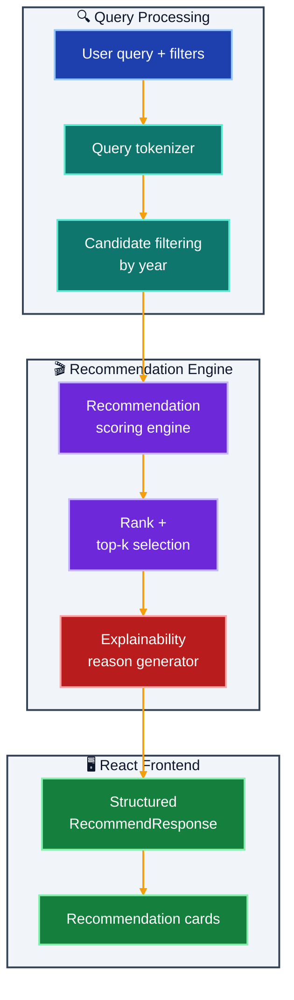

# MovieMuse Recommender

Semantic movie recommendation starter with metadata-aware retrieval hooks.

## What It Does

- Parses free-text movie intent queries
- Scores catalog entries by genre, tag, and title overlap
- Applies optional year filtering
- Returns ranked recommendations with human-readable reasons

## Implemented Feature Slice (Project 07)

- Query parsing into semantic tokens
- Recommendation scoring by genre/tag/title overlap
- Optional year-range filtering
- Ranked recommendations with explainable reasons
- Structured request/response schemas for predictable frontend integration

## Architecture



## Outcome

- Delivers relevant movie suggestions from natural language prompts
- Makes recommendation logic interpretable through explicit reasons
- Establishes a clean base for adding vector embeddings and reranking later

## Quick Start

### Prerequisites

- [UV](https://docs.astral.sh/uv/) installed
- [Node.js 20+](https://nodejs.org/)

### 1. Backend

```bash
cd moviemuse-recommender/backend
uv sync

cp .env.example .env   # all values have sensible defaults

uv run uvicorn app.main:app --reload --port 8000
```

### 2. Frontend

```bash
cd moviemuse-recommender/frontend
npm install
npm run dev
# → http://localhost:5173
```

### 3. Docker Compose (optional)

```bash
docker-compose up --build
```

---

## Environment Variables

| Variable | Default | Description |
|---|---|---|
| `FRONTEND_ORIGIN` | `http://localhost:5173` | CORS allowed origin for the React frontend |
| `LOG_LEVEL` | `INFO` | Python logging verbosity (`DEBUG` \| `INFO` \| `WARNING` \| `ERROR`) |

---

## Project Structure

```
moviemuse-recommender/
├── backend/
│   ├── app/
│   │   ├── api/routes.py            # POST /api/recommend, GET /api/health
│   │   ├── core/config.py           # Pydantic Settings — CORS, log level
│   │   ├── models/schemas.py        # RecommendRequest, RecommendResponse, MovieRecommendation
│   │   ├── services/recommend.py    # Tokenizer, scorer, year filter, reason builder
│   │   └── main.py
│   ├── pyproject.toml
│   └── .env.example
├── frontend/
│   ├── src/
│   │   ├── App.jsx                  # Query input + filter controls + recommendation cards
│   │   └── lib/api.js               # fetchRecommendations() typed API call
│   └── package.json
├── docker-compose.yml
└── README.md
```

---

## API Reference

### `POST /api/recommend`

**Request:**

```json
{
  "query": "movies like Inception but more emotional",
  "top_k": 5,
  "year_min": 2000,
  "year_max": 2024
}
```

**Response:**

```json
{
  "query": "movies like Inception but more emotional",
  "top_k": 5,
  "recommendations": [
    {
      "title": "Interstellar",
      "year": 2014,
      "genres": ["Adventure", "Drama", "Sci-Fi"],
      "score": 0.82,
      "reason": "Matched on 'sci-fi', 'adventure'; strong emotional arc; genre score 0.70, tag score 0.80"
    }
  ]
}
```

### `GET /api/health`

```json
{ "status": "ok" }
```

---

## Logging

- Python logging is configured in app startup and controlled by LOG_LEVEL.
- Frontend API logging is controlled by VITE_LOG_LEVEL.
